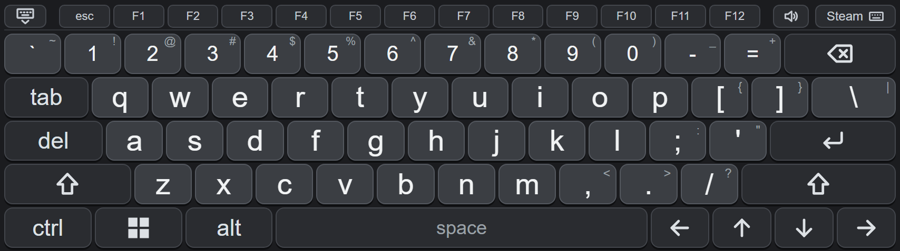
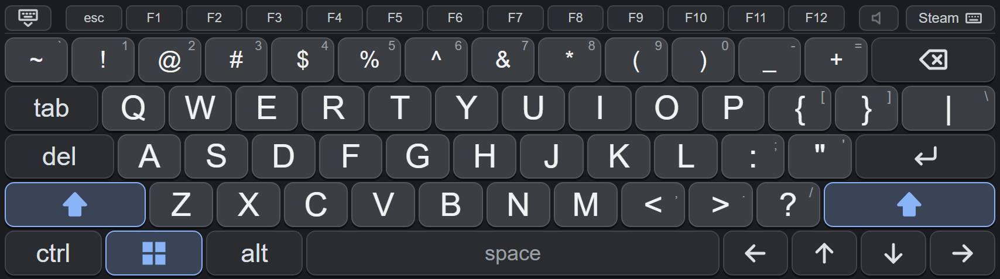

# frame-keyboard

A full PC-style QWERTY keyboard for the Steam Frame's VR keyboard (SteamVR keyboard). It draws over Steam's own keyboard and types through it, so it works anywhere the stock keyboard does. No Steam files are modified: the script runs inside the Steam client (SharedJSContext) and is injected over the Chrome DevTools Protocol.

> **Unofficial tool.** Not affiliated with Valve. It relies on undocumented parts of Steam, so a Steam update can break it. Use it at your own risk.



*Caps Lock on (filled Shift arrows), Meta armed (highlighted), click sound off (muted speaker):*



## Features

- Full PC layout: number row, Tab, Del, Enter, Shift (tap once for one capital, double tap for Caps Lock, shown as a filled arrow), Backspace, Space and the four arrow keys, all with auto-repeat where it makes sense.
- **Ctrl, Alt and Meta** one-shot modifiers. Tap a modifier, then tap a key to send the chord (Ctrl then C copies, Alt then Tab, Meta then R, and so on). Tap the modifier again to cancel it.
- **Meta, twice:** tap Meta once and it waits for the next key. Tap it a second time, with no time limit in between, and it is sent on its own: on Windows this opens the Start menu. The key shows the Windows logo on Windows and the Steam logo on SteamOS.
- Esc and F1 to F12 in a strip above the keys.
- Shifted symbols shown in the corner of each key.
- A key click sound. The speaker button in the strip turns it on and off (the sound waves disappear when it is off).
- Optional automatic capital letter after `. `, `! `, `? ` or a new line (off by default).
- A close button (keyboard with a down chevron) at the top left, and a **Steam** button with a small keyboard icon at the top right that switches back to the stock keyboard at any time. A small round keyboard-icon button at the top right of the popup brings this keyboard back.
- Keeps the stock keyboard hidden behind it, and stops controller buttons from reaching it.

## Requirements

- A Steam Frame (or a SteamOS / Linux machine running Steam) with **developer mode** enabled. Developer mode makes Steam open a local-only debugging port, `127.0.0.1:8080`, which is what the keyboard uses. On Windows the installer enables that port itself.
- Linux only: `python3` with `aiohttp` (already present on the Frame). Windows needs nothing extra (Windows PowerShell 5.1 or newer, which ships with Windows 10 and 11).
- Node.js and npm only if you install from the source instead of a release.
- No `sudo` is needed.

## Install

### Windows

Download `frame-keyboard-<version>-windows.zip` from the [Releases page](https://github.com/Izimzizi/frame-keyboard/releases), extract it, and double-click `install.cmd` (or run `install.ps1` in PowerShell). Nothing else needs to be installed and no administrator rights are needed. The installer:

1. creates an empty `.cef-enable-remote-debugging` file next to `steam.exe`, which makes Steam open its debugging port (`127.0.0.1:8080`, reachable only from this PC) the next time it starts;
2. copies the files to `%LOCALAPPDATA%\frame-keyboard`;
3. registers a Scheduled Task named `frame-keyboard` that runs the injector with no window at every logon and injects the keyboard again after every Steam restart.

**Restart Steam once afterwards** (or run `install.ps1 -RestartSteam`). The log is `%LOCALAPPDATA%\frame-keyboard\injector.log`. To remove it, double-click `uninstall.cmd` from the zip (or run `install.ps1 -Uninstall`; add `-RemoveFlag` to delete the `.cef-enable-remote-debugging` file too) and restart Steam.

### Linux / SteamOS / Steam Frame

#### From a release (recommended)

On the device (for example in Konsole), download the latest archive from the [Releases page](https://github.com/Izimzizi/frame-keyboard/releases), then:

```sh
tar xzf frame-keyboard-*.tar.gz
cd frame-keyboard
./install.sh
```

The archive already contains the built bundle, so Node.js is not needed. Releases are built by GitHub Actions from a version tag; `SHA256SUMS` is attached for checking the download.

#### From the source

```sh
git clone https://github.com/Izimzizi/frame-keyboard.git
cd frame-keyboard
./install.sh
```

From a checkout `install.sh` builds the bundle first, which needs Node.js and npm (or build elsewhere, see [Building](#building), and put `dist/bundle.js` next to `install.sh`).

`install.sh` copies the files to `~/.local/share/frame-keyboard`, and installs and starts a systemd **user** service named `frame-keyboard`. The service waits for Steam, injects the keyboard, and injects it again after every Steam restart. Run the install again from a newer release to update. A leftover install of the earlier `frame-jp-keyboard` is removed automatically.

Useful commands:

```sh
journalctl --user -u frame-keyboard -f                              # logs
python3 ~/.local/share/frame-keyboard/frame_keyboard_injector.py --once   # inject again right now
systemctl --user restart frame-keyboard                             # restart the service
```

## Uninstall

From the extracted release folder, right-click `uninstall.sh` and choose Run in Terminal, or:

```sh
./uninstall.sh      # same as ./install.sh --uninstall
```

The code stays loaded in the running Steam client until Steam is restarted (or the device is rebooted), then the stock keyboard is back.

## Settings

Settings are stored in Steam's local storage. There is no settings screen; change them from the Steam CDP console through `window.__fjk`, then call `__fjk.setEnabled(true)` to save:

| Setting | Default | Meaning |
|---|---|---|
| `sound` | `true` | Play a click when a key is pressed (also the speaker button) |
| `autoCapitalize` | `false` | Capitalize the first letter after `. `, `! `, `? ` or a new line |
| `metaCode` | `102` | USB HID key code sent for Meta. Change it with `__fjk.debug.setMetaCode(227)` if your system uses another code |
| `debugRecorders` | `false` | Log diagnostics (raw input, gestures, Steam keyboard calls; never the text you type). Takes effect on the next injection |

Example: `__fjk.settings.autoCapitalize = true; __fjk.setEnabled(true)`.

## Troubleshooting

- **Nothing happens when the keyboard opens:** check that developer mode is on and that the service is running (`systemctl --user status frame-keyboard`). The log should show `connected to SharedJSContext` and `injected`.
- **The stock keyboard shows instead:** tap the small keyboard-icon button at the top right to bring this keyboard back, or run the `--once` command above.
- **Ctrl, Alt, Esc, F-keys or Meta do nothing:** the log then says `this Steam client has no key-state call`. That Steam build does not offer the call these keys need.
- **Meta does not open the menu:** your system may use a different key code. Try `__fjk.debug.rawKey(227)` and set the working code with `__fjk.debug.setMetaCode(...)`.

## Building

```sh
npm install
npm run build   # writes dist/bundle.js
npm test        # unit tests
```

Layout of the source:

| Path | Purpose |
|---|---|
| `src/main.js` | Entry point: key handling, modifiers, open/close tracking |
| `src/ui.js`, `src/styles.js`, `src/layout.js`, `src/icons.js` | The on-screen keyboard |
| `src/steam.js`, `src/output-plan.js` | Sending text and keys through Steam's keyboard manager |
| `src/key-chords.js`, `src/shift.js`, `src/sentence-tracker.js` | Modifiers, Shift and auto-capitalization |
| `src/stock-guard.js`, `src/bounds.js`, `src/cursor-tracker.js` | Hiding the stock keyboard, placement, laser input |
| `injector/frame_keyboard_injector.py` | Injects `dist/bundle.js` into Steam over CDP (Linux) |
| `windows/` | The same injector in PowerShell, plus `install.ps1` / `install.cmd` (Windows) |
| `contrib/frame-keyboard.service` | systemd user unit |

## License

MIT. See [LICENSE](LICENSE).

## Credits

This project is a fork of [frame-jp-keyboard](https://github.com/sasaken1102r/frame-jp-keyboard) by **sasaken1102r**, who created the original keyboard overlay and the way it hooks into the Steam client. This version keeps the QWERTY keyboard and removes the Japanese input, the update checker and the other parts that were specific to the original. Many thanks to sasaken1102r for the original work.
